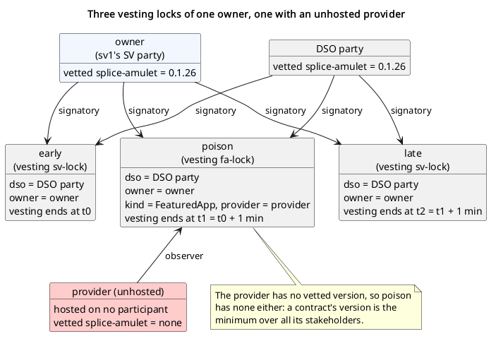
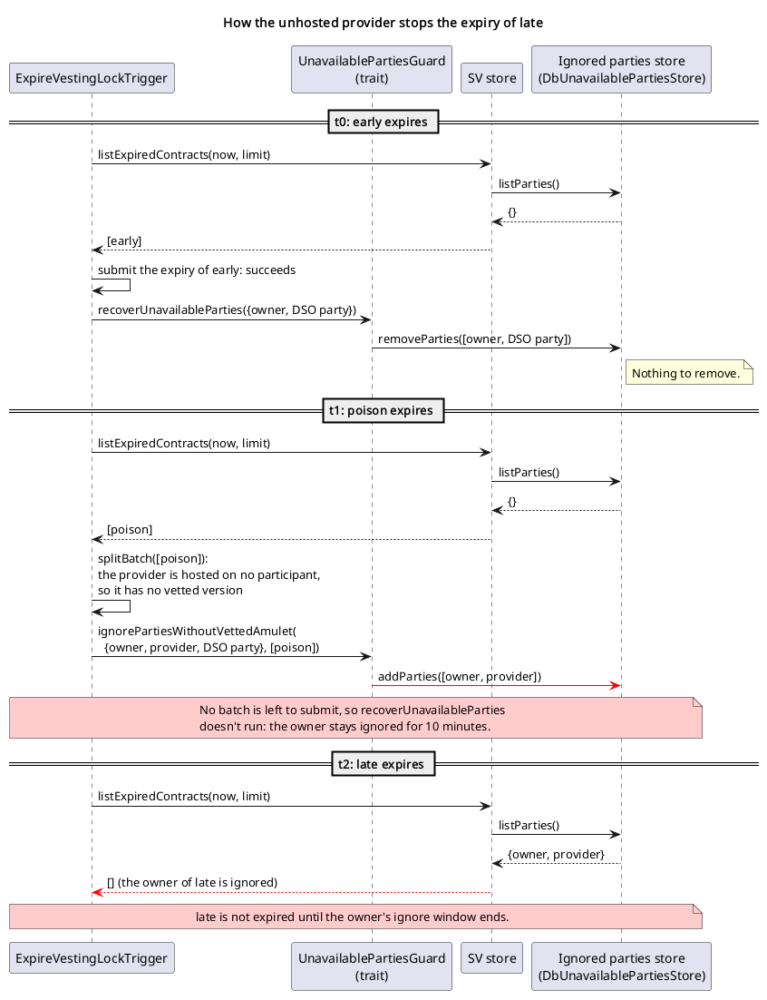

# Integration test: an unhosted fa-lock provider and its owner's later locks

The test states the behaviour we want: when one vesting lock can't be expired,
the other locks of its owner still are. But it fails exactly where
`ExpireVestingLockTrigger` stalls, and its failure is the demonstration.

With `enablePersistedUnavailableParties = true`, a successful expiry of one of
the owner's locks takes the owner off of the ignore list again. The test is
built such that a "poison lock" is expired alone: there is no other lock to form
a healthy batch alongside that would recover the "poison lock" from the ignore party. As the result, the test fails as intended.

The test is "a vesting lock whose provider is no longer hosted stops expiry of
its owner's later locks" in
`apps/app/src/test/scala/org/lfdecentralizedtrust/splice/integration/tests/ExpireVestingLockStallTimeBasedIntegrationTest.scala`.

## The locks



sv1's SV party owns three vesting locks. Each comes
due one minute after the previous one:

| Label  | Kind    | Stakeholders               | Vesting ends  | Expired |
|--------|---------|----------------------------|---------------|---------|
| early  | sv-lock | owner, DSO party           | t0 (00:05:11) | run 1   |
| poison | fa-lock | owner, DSO party, provider | t1 (00:06:11) | never   |
| late   | sv-lock | owner, DSO party           | t2 (00:07:11) | never   |

The provider is an observer of `poison` and is hosted on no participant.
Vesting ends are in sim time. The contracts are `early` `00e6086b1ba8`,
`poison` `006b13bb2972` and `late` `007cbbcf1368`.

## Steps

1. Allocate a fresh provider party on sv1's participant.
2. sv1's SV party creates the three vesting locks: lock the full amount
   with `tsv1Operations.createGovernanceLock`, then unlock all of it into
   a vesting lock.
3. Remove the provider's only `PartyToParticipant` mapping with
   `ensurePartyToParticipantRemoved(...,
   ForceFlag.DisablePartyWithActiveContracts)`.
4. Advance 2m10s and `runOnce` (sim 00:05:20); advance 1 minute and
   `runOnce` (00:06:20); advance 1 more minute and `runOnce` (00:07:20).

Assertions (the desired behaviour):

1. After run 1, `poison` and `late` remain: `early` is expired. This is
   the control that the trigger works.
2. After run 2, `poison` and `late` remain: `poison` can't be expired,
   and `late` isn't due.
3. After run 3, only `poison` remains.

**The last assertion fails!!!!**

## Cause: all informees of a contract are marked as ignored

`BatchedMultiDomainExpiredContractTrigger.splitBatch` asks
`PackageVettingLookupService` for a vetted `splice-amulet` version for every
stakeholder of each listed lock. For the unhosted provider the lookup fails with
`UNKNOWN_INFORMEES`, so `poison` gets version `None`. `splitBatch` drops it and
calls `ignorePartiesWithoutVettedAmulet` with **all of its stakeholders**
regardless if they all have a vetted version or not. It marks two parties as
ignored: both the provider and the owner. The `poison` lock is never submitted,
and nothing about it is logged at WARN or above. But this leaves `owner` in the
ignore parties list resulting in the next lock (`late`) not being picked up for
processing because the `late`'s `owner` is in the ignore list.

## What happens



The diagram shows the three runs:

1. **t0, run 1**: the listing returns `early`. Its expiry succeeds, and
   `recoverUnavailableParties` has nobody to remove.
2. **t1, run 2**: the listing returns `poison` alone. `splitBatch` drops
   it and marks the owner and the provider. No batch is left to submit,
   so nothing recovers the owner.
3. **t2, run 3**: the listing filters ignored parties on `owner`, so it
   hides `late` (and `poison`). The run finds no work.

Run 1, at sim 00:05:20:

```
21:58:53.889 ExpireVestingLockTrigger: Processing ReadyTask(
  readyAt = 1970-01-01T00:05:15Z, work = Batch(vettedVersion = 0.1.26,
  numExpiredContracts = 1, expiredContractCids = 00e6086b1ba8...,
  stakeholders = Set(digital-asset-2-2efa1fff::122056d4dea5...,
                     DSO-2efa1fff-2efa1fff::1220ec207397...)))
21:58:54.846 ExpireVestingLockTrigger: Completed processing with outcome:
  archived 1 expired vesting locks
21:58:54.848 Stall evidence, run 1: took 979 ms,
  remaining=Vector(poison, late), ignored parties=Vector(),
  0 WARN+ entries
```

Run 2, at sim 00:06:20 (`380000000` µs):

```
21:58:57.397 SpliceLedgerConnection: No preferred packages found for
  packageRequirements List((splice-amulet,List(stall-provider-6a964a74::
  122056d4dea5...))) on synchronizer global-domain::1220ec207397... with
  vetting time 1970-01-01T00:06:20Z: UNKNOWN_INFORMEES(11,bd5d7215): The
  participant is not connected to any synchronizer where the given
  informees are known.
21:58:57.398 DbUnavailablePartiesStore: Marking 2 parties as unavailable
  at 380000000
21:58:57.400 Stall evidence, run 2: took 7 ms,
  remaining=Vector(poison, late),
  ignored parties=Vector(digital-asset-2-2efa1fff::122056d4dea5...,
                         stall-provider-6a964a74::122056d4dea5...),
  0 WARN+ entries
```

Run 3, at sim 00:07:20:

```
21:58:59.270 Stall evidence, run 3: took 1 ms,
  remaining=Vector(poison, late),
  ignored parties=Vector(digital-asset-2-2efa1fff::122056d4dea5...,
                         stall-provider-6a964a74::122056d4dea5...),
  0 WARN+ entries
```

The log has no "Submission succeeded, recovered ... unavailable
parties" line: no submission involved an ignored party.

## Result: fails at assertion 3, `late` is not expired

```
Vector(ContractId(006b13bb2972...), ContractId(007cbbcf1368...)) was not
equal to List(ContractId(006b13bb2972...))

Tests: succeeded 0, failed 1, canceled 0, ignored 0, pending 0
```

Run 3 takes 1 ms because the listing's `owner NOT IN (ignored)` filter
hides both remaining locks.

## What this shows

- A lock whose provider is unhosted makes the SV ignore the lock's
  owner, although only the provider lacks a vetted version:
  `ignorePartiesWithoutVettedAmulet` gets all stakeholders of the dropped
  lock. The owner's locks that come due next are hidden, here `late`.
- With the persisted store, the owner is recovered as soon as a batch
  with the owner as a stakeholder is submitted successfully. That
  happens only when another lock of the owner is due in the same run as
  `poison`; the test avoids that by giving each lock its own run.
- Otherwise the owner stays hidden for the ignore window
  (`UnavailablePartiesBackoffParameters`: 10 minutes of the SV app's
  clock, doubled each time the party is marked again, up to 24 hours).
  This test stays within the first window: its sim time advances 4m10s
  in total.
- With the code defaults (both flags `false`), the SV uses
  `InMemoryUnavailablePartiesStore`, which never removes a party it
  added. The owner is then ignored, in this and every other delegate-less
  trigger that shares `unavailablePartiesStore`, until the SV app
  restarts.
